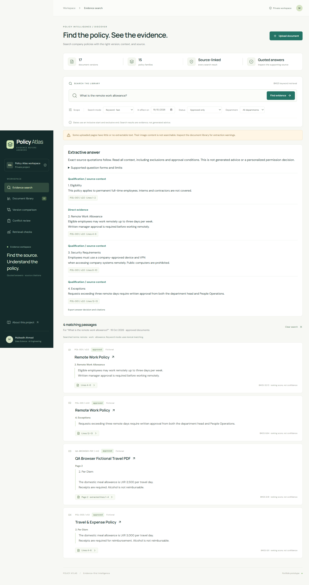
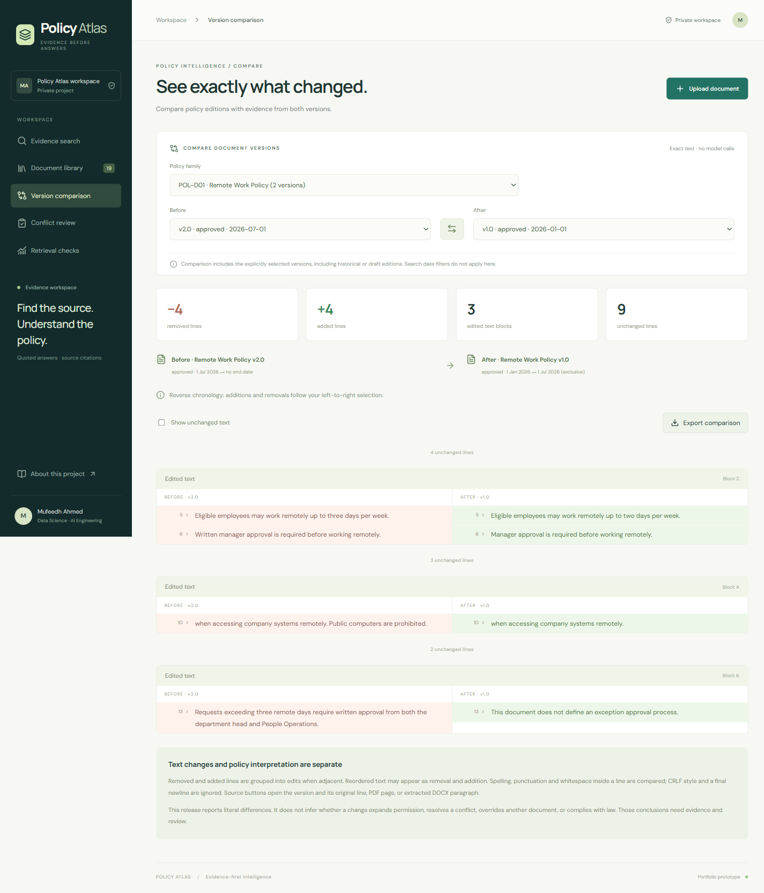

# Policy Atlas

**Find the relevant policy version, inspect its evidence, and keep qualifications attached to the answer.** A single-user local AI/ML engineering portfolio application by Mufeedh Ahmed.

Policy rules change across editions, and a plausible search result can omit an exclusion or approval condition. Policy Atlas combines filtered retrieval, exact source quotations, version comparison and saved human review to make that evidence inspectable. Intended users are a student demonstrating applied ML engineering and an individual reviewer exploring synthetic or permission-cleared policies on their own Windows machine. It is not a compliance authority or enterprise deployment.

Behavioral baseline: verified local release **`c788ff1`**. No paid model API, cloud account or cloud resources are required. Public deployment is deferred; development sign-in provides **no real multi-user security**.

## Features

- TXT, text-based PDF and DOCX ingestion with manual metadata, versions, extracted source locations and original downloads.
- BM25 keyword or optional pretrained MiniLM semantic retrieval, filtered by date, approval status and department.
- Bounded extractive answers with exact quotations, qualifications and verified document/version/location references; explicit refusal when support rules are not met.
- Literal version comparison, both-version source navigation and export.
- Rule-based potential-conflict review with both-source evidence, saved human notes and revision protection.
- Local metadata/text/notes storage, original-file storage and backup/restore tools.

Semantic retrieval uses **pretrained ML inference**; answering uses **deterministic extraction/support rules**; conflict detection uses **four narrow English pattern families**. No generative model, project-specific model training or OCR is implemented. Similarity is not answer confidence.

## Screenshots

Actual synthetic-policy rehearsal captures, not mockups. The answer image includes an expected warning from a separate mixed scanned-PDF fixture; it does not imply OCR support. [Capture provenance](docs/screenshots/README.md).





## Run locally on Windows

Use **Node 24** and **pnpm 11.25.0**. From the project folder in PowerShell:

```powershell
pnpm.cmd install --frozen-lockfile
pnpm.cmd build
pnpm.cmd local:db
pnpm.cmd dev
```

Open `http://127.0.0.1:5173/signin-with-chatgpt?return_to=/`. Default startup binds to loopback. Do not expose the app through LAN binding, tunnels or port forwarding. Use non-sensitive synthetic documents.

[LOCAL_SETUP.md](docs/LOCAL_SETUP.md) covers prerequisites, portable tools, the Windows launcher, troubleshooting and backups. Initial dependency installation needs network access; model assets are served by the local app and inference runs on-device. The release rehearsal reused installed dependencies; fresh-machine/full reinstall remains unverified. Source exports are not backups of your library.

## Architecture and demonstration

The React/TypeScript browser extracts text, loads the local corpus through TypeScript APIs, filters/ranks passages and selects source quotations. Citation checks resolve stored sections and exact versions. The local Worker uses Drizzle with **emulated D1** for metadata/text/notes and **emulated R2** for original bytes; no cloud provisioning is involved.

[Architecture diagram and walkthrough](docs/ARCHITECTURE.md) explain ingestion → retrieval → extractive answering → citations, plus comparison and conflict review. [The 3:50 demo script](docs/DEMO_SCRIPT.md) supplies exact inputs and narration. Ask `What is the remote work allowance?` with Approved only, People and date `2026-10-19`; inspect qualifications. Then ask `What is the remote work insurance allowance?` to demonstrate refusal.

## Evaluation and verification

| Measurement | Recorded result | Meaning |
|---|---|---|
| Answerable questions | **16/20 correct (80%)** | Four answerable paraphrases were falsely refused |
| Insufficient-evidence questions | **20/20 correctly refused** | Zero unsupported answers in this 20-case sample |
| Quotation/citation references | **96/96 valid** | Reference integrity, not independent proof of semantic support |

The keyword-retrieval/extractive pipeline had a once-run, **internally authored synthetic evaluation** with a reserved 20/20 split frozen before tuning. The same coding agent authored fixtures and implementation; document families share templates. The final set is consumed. This is not independent evaluation, general reliability evidence or proof of zero unsupported answers outside this sample. See [every failure and provenance](docs/ANSWERING_RESULTS.md), [raw evidence](evaluation/answering/final/) and [Python evaluator guide](docs/ANSWERING_LEARNING.md).

Latest configuration-migration checks at `c788ff1` passed: **101 Node tests, seven Python evaluator unit tests, typecheck and build**. The [migration record](docs/LOCAL_CONFIG_MIGRATION.md) verifies neutral `local-bindings.json` configuration, unchanged identity/storage behavior and source/checkpoint exports. The following browser and restore evidence comes from the prior `b806210` behavior rehearsal: **26 distinct functional browser scenarios passed across main and corrected focused runs**, plus an isolated restored-app check; this was not one uninterrupted green 26-test run. Restoration verified 11 documents, 11 original downloads and 10 notes without replacing the active library; the configuration migration rechecked those documents/downloads/notes through isolated HTTP checks. A new full browser suite was not run for the configuration-only migration. These checks do not establish answer accuracy. [Actual results and initial test-harness failures](docs/LOCAL_RELEASE_CHECKLIST.md#release-decision-and-final-browser-results).

## Limitations and next steps

- Narrow question grammar can refuse answerable paraphrases. Retrieval scores and quote existence do not prove semantic support or policy authority.
- PDF/DOCX can lose layout/content. Original-file fidelity was sampled on simple fixtures, not enforced by server re-extraction. DOCX references are body paragraphs, not Word pages. No OCR.
- One trusted local operator only; owner predicates and mock sign-in are not shared-host security. [Deployment blockers remain open](docs/DEPLOYMENT_SECURITY_REVIEW.md).
- Backups contain private plaintext; restore checks used matching application/dependency versions. No power-loss or cross-version guarantee.

[PROJECT_STATUS.md](PROJECT_STATUS.md) is the capability inventory. [ROADMAP.md](ROADMAP.md) retains independent-evaluation gaps and deferred requirements. Python work includes an offline evaluator; FastAPI is not implemented. [CV and LinkedIn drafts](docs/PORTFOLIO_DRAFTS.md) are for review only.

## Technical records and attribution

Detailed [setup/export instructions](docs/LOCAL_SETUP.md), [release checklist](docs/LOCAL_RELEASE_CHECKLIST.md), [repository audit](docs/REPOSITORY_AUDIT.md), [implementation history](docs/IMPLEMENTATION_HISTORY.md) and [Git provenance](docs/GIT_CHECKPOINT.md) retain operational and historical evidence.

Developed by Mufeedh Ahmed. Third-party model, parser, runtime and starter license notices are retained; [the repository audit](docs/REPOSITORY_AUDIT.md) lists them. A project-wide public-source license remains the author's decision before redistribution.
