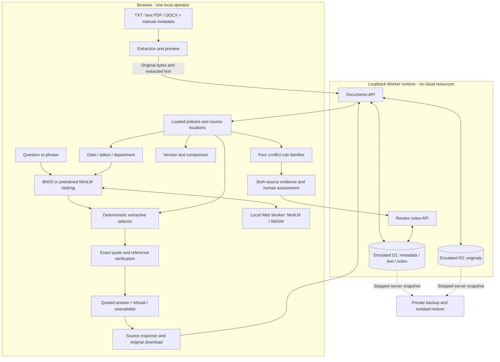

# Local architecture walkthrough

Current local release: `c788ff1` (configuration-only migration after the `b806210` behavior rehearsal). One Windows operator; all storage below is local emulation. [Setup](LOCAL_SETUP.md), [capability inventory](../PROJECT_STATUS.md) and [release evidence](LOCAL_RELEASE_CHECKLIST.md) remain authoritative.

## Ingestion → storage

[Upload UI](../app/page.tsx) collects document ID/version, dates, department and status, and previews [browser extraction](../lib/extract-client.ts): PDF.js pages, Mammoth DOCX body paragraphs or TXT lines. Metadata is manual; “approved” is not an authenticated organizational approval workflow.

[Documents API](../app/api/documents/route.ts) applies [metadata](../lib/upload.ts) and [file/extraction bounds](../lib/ingestion.ts), stores text/metadata/hashes in [D1 tables](../db/schema.ts) and originals in R2. State is local under `.wrangler/state`. D1/R2 changes do not share an atomic transaction.

The browser supplies PDF/DOCX extracted text. The server does not independently match it to the original through re-extraction. Quote verification establishes a match to stored extraction, not original-file meaning/layout. [Sampled original comparisons](LOCAL_RELEASE_CHECKLIST.md) retain this distinction.

## Retrieval → extractive answering → citations

The browser loads the local corpus; there is no search/answer backend service. [Core sections/BM25](../lib/core.ts) and [retrieval helpers](../lib/retrieval.ts) apply scope and represent TXT sections, PDF pages or DOCX paragraphs.

Optional [semantic search](../lib/semantic-client.ts) uses [a local Web Worker](../public/semantic/worker.mjs), Transformers.js and pretrained quantized MiniLM/WASM. Mean-pooled normalized vectors rank chunks by similarity. Model/runtime assets come from the local app; remote model loading is disabled. This is pretrained inference, not training. Failure/cancellation offers keyword fallback. Hybrid ranking exists in code/evaluation, not a claimed UI mode.

Ranking finds candidate evidence; it does not establish a requested fact. [The bounded answerer](../lib/answering.ts) recognizes direct limits, deadlines, approvals, eligibility and requirements. It checks approved/date/department scope, predicates, ambiguity and context bounds, including eligible sections beyond ranked hits. [The protocol](ANSWERING_PROTOCOL.md) defines supported forms and sufficiency/refusal rules.

Answers retain exact passages and qualification context, including exclusions and approval/exception conditions. Citation verification resolves row/document/version, passage/location and quote against eligible stored sources. [The answer view](../app/extractive-answer.tsx) distinguishes answered, refused and unavailable; it opens evidence and exports decisions. No generative-model prose is produced. Narrow grammar explains the recorded false refusals.

## Version comparison and potential-conflict review

[Comparison](../lib/compare.ts) uses normalized lines, bounded LCS and coarse fallback. [Its UI](../app/version-comparison.tsx) exposes explicit versions, direction, source links and export. Selecting a draft/historical edition does not make it current. Literal edits are not semantic/legal conclusions.

[Conflict rules](../lib/conflicts.ts) cover remote-work days, domestic meals, incident deadlines and personal cloud storage. [The review view](../app/conflict-review.tsx) shows both sources with date/status/scope qualifications and human assessment. No learned contradiction model or authority resolution exists; no finding does not prove compatibility.

[Review APIs](../app/api/conflict-reviews/route.ts) persist notes/status by pair/date. Source signatures flag stale context; expected revisions prevent silent concurrent overwrites. This is editable review, not immutable audit history.

## Local trust and evaluation boundaries

[Vite](../vite.config.ts) reads non-secret `DB`/`BUCKET` binding names from [local-bindings.json](../local-bindings.json); local builds no longer require `.openai/hosting.json` or emit Sites hosting metadata. [The migration record](LOCAL_CONFIG_MIGRATION.md) preserves verification and historical archive compatibility. Vite and [the CLI](../scripts/run-framework.mjs) default to loopback. Mock sign-in is a convenience identity, not multi-user authentication. APIs trust identity headers; [deployment blockers](DEPLOYMENT_SECURITY_REVIEW.md) are deferred, not solved.

[Backup tools](../scripts/local-backup.mjs) snapshot stopped-server emulator state with hashes. [The release rehearsal](LOCAL_RELEASE_CHECKLIST.md) verified restored documents/originals/notes through real endpoints and UI in isolation, leaving active state unchanged.

[The offline Python scorer](../scripts/evaluate_answers.py) evaluates saved predictions/annotations outside the browser. A separate scoring process is not independently authored evaluation: the same coding agent authored fixtures and implementation, with templated policies. [Results](ANSWERING_RESULTS.md) retain all failures and limits. Preparing a demo requires no new final evaluation.
